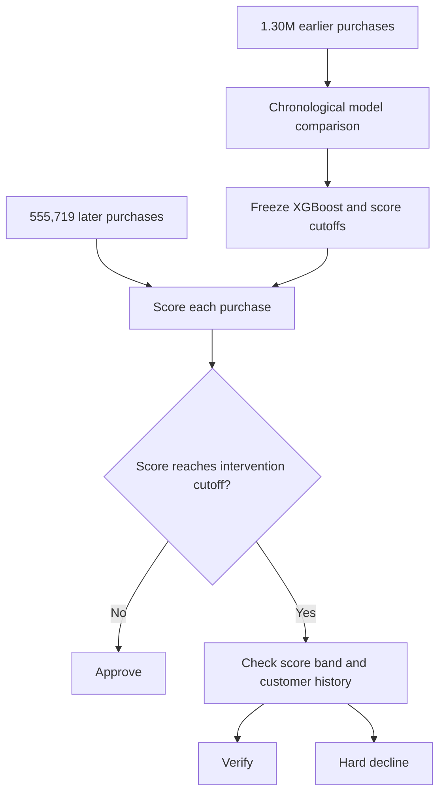
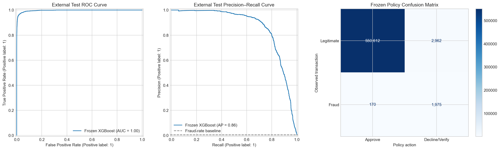

# Credit card fraud detection and transaction decisions

   

How much fraud can a payments team catch while interrupting fewer than 1% of purchases? I built a model that ranks card transactions by risk and a policy that uses customer history to choose between approval, verification and hard decline. On 555,719 held-out simulated purchases, the policy flagged **92.07% of fraud cases** and **97.00% of fraud dollars** while intervening on **0.89% of transactions**.

## Key results

| Six-month holdout | Result |
| --- | ---: |
| Fraud cases flagged | 1,975 of 2,145 |
| Fraud exposure flagged | $1,099,285 of $1,133,325 |
| Purchases sent to verification or hard decline | 4,937 of 555,719 |
| Legitimate purchases flagged | 2,962 |
| Precision among interventions | 40.00% |
| Average precision, validation → holdout | 0.9145 → 0.8624 |

**The customer trade-off:** for every ten alerts, about four were fraud and six were legitimate. The 97% figure measures the value of fraudulent purchases flagged. Realized savings depend on what happens after verification or decline.

## Workflow



## Methodology

1. **Build a purchase history.** Use amount, category, time and location to describe the transaction. For routing, compare the purchase with the customer’s earlier spending and merchant visits. Online shopping had the highest observed fraud rate, while in-person grocery purchases generated the most cases.
2. **Select the risk model.** Fit on the earliest 70% of the training file and validate on the latest 30%. Tune within the earlier period. Across seven classifiers, class-weighted XGBoost achieved **0.9145 validation average precision**, ahead of tuned LightGBM (0.8998) and the best synthetic-oversampling experiment (0.8925). Average precision measures how consistently fraud ranks near the top of the list.
3. **Turn scores into actions.** Select cutoffs on validation data, freeze them, then score the later holdout before revealing its labels. The intervention cutoff determines which purchases get flagged. Within that group, an extreme score plus several warning signs can trigger a hard decline. Other flagged purchases go to verification.
4. **Audit customer matching.** The two files formatted birth dates differently, making returning customers appear new. Standardizing dates restored history for **908 of 924** test profiles. At the same scores and cutoffs, **245 purchases changed action**. Legitimate hard declines fell from **214 to 143**, and fraudulent hard declines fell from **1,451 to 1,281**. All 4,937 alerts remained in the intervention queue. [Audit results](results/history_routing_audit.csv)

## Visualizations



The precision–recall curve shows what the team gives up as it widens the alert threshold. The confusion matrix shows the workload at the chosen cutoff, including **170 missed fraud cases**. [Threshold results](results/final_test_threshold_results.csv) · [Results by decision rule](results/final_test_rule_results.csv)

### Follow-up study: a fixed daily verification queue

In a separate local study, I replayed **195,723 purchases over 80 days** from the original training file. Each decision was final at arrival. Both policies could use up to **22 verifications and eight hard declines per day**. The four notebooks published here reproduce the six-month holdout above. The table below summarizes the subsequent development study.

| Arrival-order policy | Frauds flagged | Legitimate hard declines | Verifications | Modeled net benefit |
| --- | ---: | ---: | ---: | ---: |
| Score alone | 952 | 1 | 1,497 | $455,464 |
| Score plus customer history and recent spending activity | 966 | 3 | 1,526 | $466,384 |

The second policy gained **$10,919** under the base assumptions. The 95% interval from resampling paired seven-day blocks was **$1,435 to $20,751**. The simulation assumed verification prevented 80% of the fraud dollars routed to it, each verification cost $3, legitimate verifications added $2 of friction, and a mistaken hard decline cost $35. A hard decline was assumed to prevent the full fraudulent amount.

## Installation and usage

**Quick demo.** From the repository root, print the holdout results and check the published totals using Python’s standard library:

```sh
python3 scripts/summarize_results.py
```

**Reproduce the baseline.** The reference environment used Python 3.9.6 on macOS. The pinned requirements include pandas, NumPy, scikit-learn, XGBoost, LightGBM, CatBoost, imbalanced-learn and Matplotlib. On macOS, install OpenMP with `brew install libomp` if it is missing.

```sh
git clone https://github.com/Tanllin/credit-card-fraud-detection.git
cd credit-card-fraud-detection
python3.9 -m venv .venv
source .venv/bin/activate
python -m pip install -r requirements.txt
```

Download and unzip version 1 of Kartik Shenoy’s simulated dataset. Pass the directory containing `fraudTrain.csv` and `fraudTest.csv` to the preparation script. It verifies both input hashes and recreates the historical date formatting. Across all test rows, the prepared data matched the original export on all 17 checked fields. [Dataset on Kaggle](https://www.kaggle.com/datasets/kartik2112/fraud-detection)

```sh
python scripts/prepare_data.py "/path/to/unzipped/dataset"
python run.py all
```

If you already have the prepared files in `Data/raw/`, start with `python run.py all`. To run just the frozen holdout evaluation, use `python run.py evaluate`.

## Repository structure

| File or folder | What to look for |
| --- | --- |
| [01 · Exploration and preprocessing](01_EDA_Preprocessing.ipynb) | Where fraud concentrates and how customer history is built |
| [02 · Model selection](02_Model_Selection.ipynb) | Chronological benchmarks and tuning |
| [03 · Class imbalance](03_Class_Imbalance.ipynb) | Class weighting versus synthetic oversampling |
| [04 · Final evaluation](04_Final_Test_Evaluation.ipynb) | Frozen policy, holdout results and customer-history audit |
| [scripts/](scripts/) | Data preparation, threshold selection and results summary |
| [results/](results/) | Aggregate tables and the holdout chart |
| [run.py](run.py) · [requirements.txt](requirements.txt) | Stage runner and pinned dependencies |

## Limitations and future work

- **Synthetic purchases and uncalibrated scores.** The risk score ranks transactions. Estimating a real customer’s fraud probability or an issuer’s savings requires representative transactions, verification outcomes and recovery data.
- **Short outages are a weak point.** In a shared-queue outage drill, a two-rule fallback caught only **3 of 41 frauds** during the affected hours. Healthy streaming caught **35** on the same purchases. Short-outage coverage and remaining queue capacity are priorities for the next test.
- **Next decision.** Compare the streaming policies side by side on a fresh period, tracking legitimate hard declines, when the verification queue fills, and the fraud dollars approved afterward.
